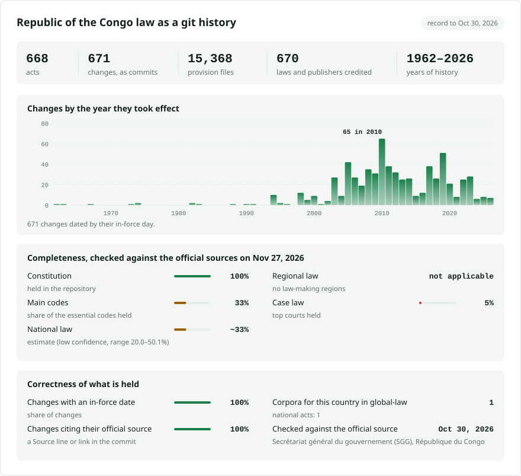

# Republic of the Congo: law history in git

[Français](README.md) · **English**

<picture>
<source media="(prefers-color-scheme: dark)" srcset="data/effort-dark.svg">

</picture>

The law of the Republic of the Congo (Brazzaville) as a git history: one file per article, one commit per version on the day it took effect, and the law that made each change as the commit's author. `git blame` names the law behind every line; `git log` lists every change to an article; picking a date gives the text in force that day.

Part of [lexifina/global-law](https://github.com/lexifina/global-law), one git history for every country's law: this is the Republic of the Congo's national law, which global-law reads at `republic-of-congo/national/acts/`.

**What is in it now:** two acts, with three versions: the Constitution of 25 October 2015 (the preamble and 246 articles) as promulgated, and with Article 157, on the state of emergency and the state of siege, as replaced by Loi constitutionnelle n° 2-2022 of 7 January 2022; and Loi n° 29-2019 of 10 October 2019 on the protection of personal data (101 articles), as enacted. Each act's `README.md` ([`constitution/README.md`](constitution/README.md)) lists every provision, how often it changed and when; [`data/laws.csv`](data/laws.csv) lists the laws behind the commits.

Each act is a folder (`constitution/`, `donnees-personnelles/`) with one file per article: `constitution/art-157.md` is Article 157 of the Constitution, and `constitution/preambule.md` its preamble.

The text is in French, as the Journal officiel prints it. An English translation is not part of this record.

## Questions as git commands

| Question | Command |
| --- | --- |
| Every change to Article 157 of the Constitution | `git log -p --word-diff -- constitution/art-157.md` |
| Which law wrote each line of Article 157? | `git blame constitution/art-157.md` |
| Every version of Article 157, with the day each took effect | `git log --format="%h %(trailers:key=In-force,valueonly,separator=) %an" -- constitution/art-157.md` |
| Article 157 as in force on 1 January 2020 | `python tools/on.py 2020-01-01 constitution 157` |

Each version is also tagged by act and day (`constitution/2015-11-06`, `constitution/2022-01-10`, `donnees-personnelles/2019-11-07`).

**Outside git**, we also host this record publicly, for free:

- **[Ask Claude about the law of the Republic of the Congo](https://global-law.lexifina.com/v1/try_claude?country=republic-of-congo)**: opens Claude with a first question ready.
- **[Ask ChatGPT](https://global-law.lexifina.com/v1/try_chatgpt?country=republic-of-congo)**: the same question in ChatGPT.
- **[Search the law of the Republic of the Congo on our site](https://lexifina.com/law?country=republic-of-congo&q=%C3%A9tat+d%27urgence)**: a search for "état d'urgence" (state of emergency), with each provision's text and its versions, no account needed.
- **[Developer REST API](https://global-law.lexifina.com/v1/search_law?query=%C3%A9tat+d%27urgence&jurisdiction=republic-of-congo)**: the same search as JSON, with no key. See the [documentation here](https://lexifina.com/api/global-law).

Both assistants read the record through the free Global law connector (MCP, `https://global-law.lexifina.com/mcp`); the first time, the chat gives you the link that adds it. Ask in French or in English.

**Host it yourself easily.** All it takes is git and Python, and the tools run on your machine:

```sh
git clone --depth 1 https://github.com/lexifina/global-law && cd global-law
python3 tools/countries.py add republic-of-congo/national/acts
python3 tools/law.py show 2026-01-01 republic-of-congo/national/acts/constitution/art-157.md
```

Opened in Claude Code, Cursor, VS Code or Codex, the clone also starts a local MCP server with the same tools ([MCP.md](https://github.com/lexifina/global-law/blob/main/MCP.md)).

## Dates

Each commit is dated at noon, Africa/Brazzaville, on the day the version took effect, and carries it in its `In-force:` trailer (the day of enactment is in `Enacted:`, the Journal officiel's in `Published:`):

- the Constitution: 6 November 2015, its promulgation (art. 246: in force "dès sa promulgation"), printed in the Journal officiel édition spéciale n° 8 of that day;
- Loi n° 29-2019 and Loi constitutionnelle n° 2-2022 name no day of their own, so each is dated by its Journal officiel issue: n° 45 of 7 November 2019 and édition spéciale n° 1 of 10 January 2022 (no general statute on when laws take effect was found on the SGG's site);
- the periods that Loi n° 29-2019 (art. 100) gives existing processing to comply are not commencement dates and do not change its date.

Each change is credited to the law that made it (`Loi constitutionnelle n° 2-2022`), and each act's first version to the act itself (`Constitution du 25 octobre 2015`, adopted by referendum); the committer is always Lexifina.

## How it is checked

- `tools/check_repo.py` reads every version back from git on the day it took effect and on the day before, and both must match the corpus the history was built from; it also checks that every commit's trailers parse, that there are no merge commits and that no commit is dated after the build. The results (0 mismatches) are in [`REPRODUCE.md`](REPRODUCE.md); no second build has been compared yet.
- `tools/build.py` writes the history from that corpus in one pass, and the same corpus always gives the same commit hashes; [`data/corpus.sha256`](data/corpus.sha256) gives the corpus's hash.
- The text is the Journal officiel PDFs' own text layer, its two columns joined and words split at line ends rejoined (`tools/jo_text.py`); the SGG's HTML copy of the Constitution, which differs in small editorial ways, is used only as a cross-check.
- [vulnerabilities/](vulnerabilities/README.en.md): possible drafting mistakes in this law, found by global-law's detectors and checked by hand. Not run yet.

## What it does not show

- **Most other law.** Other codes and laws are not yet included. The Code pénal has no text here: the SGG lists it as the French code applied by the arrêté of 13 February 1882, not published in the Journal officiel; the SGG's copy of the Code de la famille (1984) is a scan, and scans are not transcribed.
- **Consolidated versions.** The Republic of the Congo publishes no official dated consolidations, so a version exists here only where a law in the Journal officiel changed the text.
- **How a provision applies**: commencement conditions, compliance periods and transitional rules are not encoded; the text shown on a day may not be the whole law that applied.
- **Headings.** Title, sub-title and chapter headings are not in the files; each file is the preamble or one article.

## Sources

| Source | Kind | Past versions | Notes |
| --- | --- | --- | --- |
| [Journal officiel de la République du Congo](https://sgg.cg) (Secrétariat général du Gouvernement) | The official gazette, as PDFs with a text layer | each issue as published | The Constitution (JO édition spéciale n° 8 of 6 November 2015), Loi n° 29-2019 (JO n° 45 of 7 November 2019) and Loi constitutionnelle n° 2-2022 (JO édition spéciale n° 1 of 10 January 2022) |

## Licence

See [`LICENSE`](LICENSE). Laws, court decisions and decisions of administrative authorities are outside the scope of copyright in the Republic of the Congo (Loi n° 24-82 of 7 July 1982, art. 14); the texts are taken from the Journal officiel as published by the Secrétariat général du Gouvernement, which does not endorse this repository. The history, commit messages, tables and tools are CC0 1.0.

No AI model wrote, translated or corrected legal text, and none runs when the history is built; the scripts were written by an AI model (see [`REPRODUCE.md`](REPRODUCE.md)).

## Visualisations

- [visualisations/](visualisations/README.en.md): charts drawn from this repository. Not drawn yet.

## More

From [lexifina/global-law](https://github.com/lexifina/global-law):

- [FEATURES.md](https://github.com/lexifina/global-law/blob/main/FEATURES.md): every feature, and what every corpus must support (`git blame`, `law.py`, the MCP tools)
- [FAQ.md](https://github.com/lexifina/global-law/blob/main/FAQ.md): questions and answers · [CONTRIBUTING.md](https://github.com/lexifina/global-law/blob/main/CONTRIBUTING.md): proposing changes · [MCP.md](https://github.com/lexifina/global-law/blob/main/MCP.md): the MCP server · [REPRODUCE.md](https://github.com/lexifina/global-law/blob/main/REPRODUCE.md): how it was built · [CHANGELOG.md](https://github.com/lexifina/global-law/blob/main/CHANGELOG.md)
- [FRESHNESS.md](https://github.com/lexifina/global-law/blob/main/FRESHNESS.md): how current each corpus is · [Monitoring](https://github.com/lexifina/global-law/tree/main/monitoring): whether updates are running · [WATCHING.md](https://github.com/lexifina/global-law/blob/main/WATCHING.md): how each official source is watched for changes
- [performance/](https://github.com/lexifina/global-law/tree/main/performance): how fast the tools are, measured
- [visualisations/](https://github.com/lexifina/global-law/tree/main/visualisations): charts and bridges across the world's law
- [Vulnerabilities](https://github.com/lexifina/global-law/tree/main/vulnerabilities): mistakes in legislation as published
