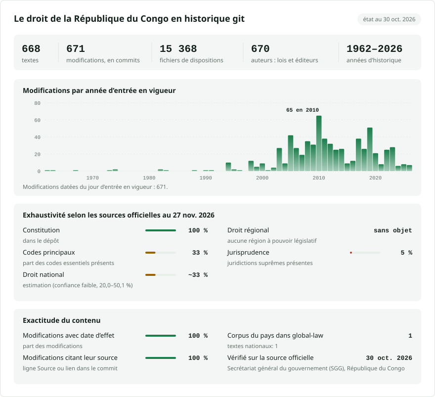

# République du Congo : l’histoire du droit dans git

**Français** · [English](README.en.md)

<picture>
<source media="(prefers-color-scheme: dark)" srcset="data/fr/effort-dark.svg">

</picture>

Le droit de la République du Congo (Brazzaville) sous la forme d’un historique git : un fichier par article, un commit par version à la date de son entrée en vigueur, et la loi auteur de chaque modification comme auteur du commit. `git blame` indique la loi à l’origine de chaque ligne ; `git log` liste toutes les modifications d’un article ; le choix d’une date donne le texte en vigueur ce jour-là.

Fait partie de [lexifina/global-law](https://github.com/lexifina/global-law), un historique git unique pour le droit de tous les pays : il s’agit ici du droit national de la République du Congo, que global-law lit sous `republic-of-congo/national/acts/`.

**Contenu actuel :** deux textes, en trois versions : la Constitution du 25 octobre 2015 (le préambule et 246 articles) telle que promulguée, puis avec l’article 157, relatif à l’état d’urgence et à l’état de siège, tel que remplacé par la Loi constitutionnelle n° 2-2022 du 7 janvier 2022 ; et la Loi n° 29-2019 du 10 octobre 2019 portant protection des données à caractère personnel (101 articles), telle qu’adoptée. Le `README.md` de chaque texte ([`constitution/README.md`](constitution/README.md)) liste chaque disposition, le nombre de ses modifications et leurs dates ; [`data/laws.csv`](data/laws.csv) liste les lois à l’origine des commits.

Chaque texte est un dossier (`constitution/`, `donnees-personnelles/`) avec un fichier par article : `constitution/art-157.md` est l’article 157 de la Constitution, et `constitution/preambule.md` son préambule.

Le texte est en français, tel que l’imprime le Journal officiel. Une traduction anglaise ne fait pas partie de ce corpus.

## Questions sous forme de commandes git

| Question | Commande |
| --- | --- |
| Toutes les modifications de l’article 157 de la Constitution | `git log -p --word-diff -- constitution/art-157.md` |
| Quelle loi a rédigé chaque ligne de l’article 157 ? | `git blame constitution/art-157.md` |
| Toutes les versions de l’article 157, avec la date d’entrée en vigueur de chacune | `git log --format="%h %(trailers:key=In-force,valueonly,separator=) %an" -- constitution/art-157.md` |
| L’article 157 tel qu’en vigueur au 1er janvier 2020 | `python tools/on.py 2020-01-01 constitution 157` |

Chaque version porte aussi une étiquette par texte et par date (`constitution/2015-11-06`, `constitution/2022-01-10`, `donnees-personnelles/2019-11-07`).

**En dehors de git**, nous hébergeons aussi ce corpus publiquement, gratuitement :

- **[Interroger Claude sur le droit de la République du Congo](https://global-law.lexifina.com/v1/try_claude?country=republic-of-congo)** : ouvre Claude avec une première question prête.
- **[Interroger ChatGPT](https://global-law.lexifina.com/v1/try_chatgpt?country=republic-of-congo)** : la même question dans ChatGPT.
- **[Rechercher dans le droit de la République du Congo sur notre site](https://lexifina.com/law?country=republic-of-congo&q=%C3%A9tat+d%27urgence)** : une recherche de « état d'urgence », avec le texte de chaque disposition et ses versions, sans compte.
- **[API REST pour développeurs](https://global-law.lexifina.com/v1/search_law?query=%C3%A9tat+d%27urgence&jurisdiction=republic-of-congo)** : la même recherche au format JSON, sans clé. Voir la [documentation ici](https://lexifina.com/api/global-law).

Les deux assistants lisent le corpus au moyen du connecteur gratuit Global law (MCP, `https://global-law.lexifina.com/mcp`) ; la première fois, la conversation vous donne le lien qui l’ajoute. Posez vos questions en français ou en anglais.

**L’héberger vous-même, simplement.** Il suffit de git et de Python, et les outils s’exécutent sur votre machine :

```sh
git clone --depth 1 https://github.com/lexifina/global-law && cd global-law
python3 tools/countries.py add republic-of-congo/national/acts
python3 tools/law.py show 2026-01-01 republic-of-congo/national/acts/constitution/art-157.md
```

Ouvert dans Claude Code, Cursor, VS Code ou Codex, le clone démarre aussi un serveur MCP local doté des mêmes outils ([MCP.md](https://github.com/lexifina/global-law/blob/main/MCP.md)).

## Dates

Chaque commit est daté à midi, heure Africa/Brazzaville, du jour où la version est entrée en vigueur, et porte cette date dans son trailer `In-force:` (la date d’adoption figure dans `Enacted:`, celle du Journal officiel dans `Published:`) :

- la Constitution : le 6 novembre 2015, date de sa promulgation (art. 246 : en vigueur « dès sa promulgation »), publiée au Journal officiel édition spéciale n° 8 du même jour ;
- la Loi n° 29-2019 et la Loi constitutionnelle n° 2-2022 ne fixent aucune date propre ; chacune est donc datée de son numéro du Journal officiel : le n° 45 du 7 novembre 2019 et l’édition spéciale n° 1 du 10 janvier 2022 (aucun texte général sur l’entrée en vigueur des lois n’a été trouvé sur le site du SGG) ;
- les délais que la Loi n° 29-2019 (art. 100) accorde aux traitements existants pour se mettre en conformité ne sont pas des dates d’entrée en vigueur et ne modifient pas sa date.

Chaque modification est attribuée à la loi qui l’a opérée (`Loi constitutionnelle n° 2-2022`), et la première version de chaque texte au texte lui-même (`Constitution du 25 octobre 2015`, adoptée par référendum) ; le committer est toujours Lexifina.

## Méthode de vérification

- `tools/check_repo.py` relit chaque version dans git le jour de son entrée en vigueur et la veille, et les deux doivent correspondre au corpus à partir duquel l’historique a été construit ; il vérifie aussi que les trailers de chaque commit sont analysables, l’absence de commits de fusion et qu’aucun commit n’est daté après la construction. Les résultats (0 écart) figurent dans [`REPRODUCE.md`](REPRODUCE.md) ; aucune seconde construction n’a encore été comparée.
- `tools/build.py` écrit l’historique à partir de ce corpus en une seule passe, et un même corpus donne toujours les mêmes empreintes de commit ; [`data/corpus.sha256`](data/corpus.sha256) donne l’empreinte du corpus.
- Le texte est la couche texte propre des PDF du Journal officiel, ses deux colonnes réunies et les mots coupés en fin de ligne recomposés (`tools/jo_text.py`) ; la copie HTML de la Constitution publiée par le SGG, qui en diffère par de légères variantes de forme, ne sert qu’au contrôle croisé.
- [vulnerabilities/](vulnerabilities/): erreurs de rédaction possibles dans ce droit, trouvées par les détecteurs de global-law et vérifiées à la main. Pas encore lancé.

## Ce qu’il ne montre pas

- **La plupart des autres textes.** Les autres codes et lois n’y figurent pas encore. Le Code pénal n’a pas de texte ici : le SGG le présente comme le code français rendu applicable par l’arrêté du 13 février 1882, non publié au Journal officiel ; la copie du Code de la famille (1984) proposée par le SGG est une numérisation, et les numérisations ne sont pas transcrites.
- **Les versions consolidées.** La République du Congo ne publie aucune consolidation officielle datée ; une version n’existe donc ici que lorsqu’une loi publiée au Journal officiel a modifié le texte.
- **Les modalités d’application d’une disposition** : les conditions d’entrée en vigueur, les délais de mise en conformité et les dispositions transitoires ne sont pas codés ; le texte affiché à une date peut ne pas constituer l’intégralité du droit alors applicable.
- **Les intitulés.** Les intitulés des titres, sous-titres et chapitres ne figurent pas dans les fichiers ; chaque fichier est le préambule ou un article.

## Sources

| Source | Nature | Versions antérieures | Remarques |
| --- | --- | --- | --- |
| [Journal officiel de la République du Congo](https://sgg.cg) (Secrétariat général du Gouvernement) | Le journal officiel, en PDF dotés d’une couche texte | chaque numéro tel que publié | La Constitution (JO édition spéciale n° 8 du 6 novembre 2015), la Loi n° 29-2019 (JO n° 45 du 7 novembre 2019) et la Loi constitutionnelle n° 2-2022 (JO édition spéciale n° 1 du 10 janvier 2022) |

## Licence

Voir [`LICENSE`](LICENSE). Les lois, les décisions de justice et les décisions des autorités administratives sont exclues du champ du droit d’auteur en République du Congo (Loi n° 24-82 du 7 juillet 1982, art. 14) ; les textes sont repris du Journal officiel tel que publié par le Secrétariat général du Gouvernement, qui n’approuve pas ce dépôt. L’historique, les messages de commit, les tableaux et les outils sont sous licence CC0 1.0.

Aucun modèle d’IA n’a rédigé, traduit ni corrigé de texte juridique, et aucun ne s’exécute lors de la construction de l’historique ; les scripts ont été écrits par un modèle d’IA (voir [`REPRODUCE.md`](REPRODUCE.md)).

Ceci est une traduction de la version anglaise ([README.en.md](README.en.md)) ; en cas de divergence, la version anglaise fait foi.

## Visualisations

- [visualisations/](visualisations/): graphiques tirés de ce dépôt. Pas encore dessinés.

## En savoir plus

Dans le dépôt [lexifina/global-law](https://github.com/lexifina/global-law) (pages en anglais) :

- [FEATURES.md](https://github.com/lexifina/global-law/blob/main/FEATURES.md): toutes les fonctionnalités et ce que chaque corpus doit prendre en charge (`git blame`, `law.py`, outils MCP)
- [FAQ.md](https://github.com/lexifina/global-law/blob/main/FAQ.md): questions et réponses · [CONTRIBUTING.md](https://github.com/lexifina/global-law/blob/main/CONTRIBUTING.md): proposer une modification · [MCP.md](https://github.com/lexifina/global-law/blob/main/MCP.md): serveur MCP · [REPRODUCE.md](https://github.com/lexifina/global-law/blob/main/REPRODUCE.md): comment il a été construit · [CHANGELOG.md](https://github.com/lexifina/global-law/blob/main/CHANGELOG.md)
- [FRESHNESS.md](https://github.com/lexifina/global-law/blob/main/FRESHNESS.md): à quel point chaque corpus est à jour · [Surveillance](https://github.com/lexifina/global-law/tree/main/monitoring): si les mises à jour fonctionnent · [WATCHING.md](https://github.com/lexifina/global-law/blob/main/WATCHING.md): comment chaque source officielle est surveillée pour repérer les modifications
- [performance/](https://github.com/lexifina/global-law/tree/main/performance): la rapidité des outils, mesurée
- [visualisations/](https://github.com/lexifina/global-law/tree/main/visualisations): graphiques et liens à travers le droit du monde entier
- [Vulnérabilités](https://github.com/lexifina/global-law/tree/main/vulnerabilities): erreurs dans les textes tels qu’ils ont été publiés
